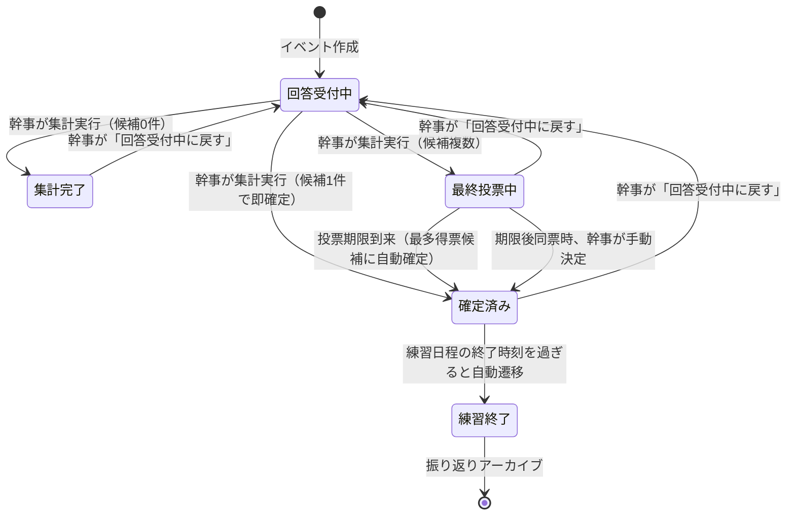

# アカペラバンド運営Webアプリ
## 基本構想・要件定義書

**バージョン：2.0（仕様確定版）**

---

## 1. アプリの概要

### 1.1 開発目的
現在所属しているアカペラバンド専用のWebアプリを開発する。
バンド活動に必要なメンバー情報、練習日程、練習場所、練習曲などを一元管理し、バンド運営を効率化することを目的とする。
将来的には、練習の記録や録音音源の共有、レパートリーの管理などにも対応し、バンド活動全体を支援するアプリを目指す。

### 1.2 基本方針
- 現在所属しているアカペラバンド専用のプライベートWebアプリとする。
- PCとスマートフォンの両方で快適に操作できるWebアプリとする。
- 個別アカウントによるログイン方式を採用する。
- **プライバシー保護・セキュリティ重視**:
  - 本名、メールアドレス等の個人情報は一切保持しない。
  - 外部からの勝手な新規登録は遮断し、管理者アカウントのみがメンバーを追加できる事前登録制とする。
- 固定の幹事は設けず、日程調整ごとに幹事を設定する。
- 日程調整の参加者全員で民主的に練習日時・場所を決定する。

---

## 2. 機能要件

### 2.1 メンバー管理機能
プライバシーに配慮し、必要最小限の項目に厳選して管理する。

管理項目：
- **ID**（半角英数字、ログイン用）
- **パスワード**（ログイン用）
- **あだ名**（バンド内表示名）
- **自己紹介・ひとこと**（任意）
- **管理者フラグ**（`isAdmin`: メンバー追加権限）
※本名、メールアドレス、希望パート、音域などの個人情報は持たない。

### 2.2 日程調整機能
幹事が日程調整を作成し、メンバーが参加可能な日時と利用可能な練習場所を回答する。
回答を集計し、参加可能人数が最大となる練習日時・場所を提示する。

主な機能：
- 日程調整の作成・一覧・詳細表示
- 候補日指定方式、期間指定方式
- 練習時間は30分刻みで設定
- **回答権限**: 回答・回答変更ができるのは「回答受付中」ステータス時のみ（集計中や投票中、確定後はロック）
- 参加可能時間帯の入力（30分単位、1日複数登録可）
- 時間帯ごとの利用可能な練習場所の選択 & 希望順位（第1希望、第2希望…）
- 登録外の練習場所のその場提案
- 回答内容の全員公開
- 最大参加可能人数による候補抽出
- **最終投票**:
  - 各候補日時に参加可能なメンバーのみに投票権を付与
  - **最終投票期限**を設定し、期限内は日程の確定を行えない（メンバー全員の意見を保護）
  - 投票期限を迎えると、**最多得票数の候補に自動で確定**
  - **期限終了後に同票の場合のみ**、同票候補の中から幹事が最終決定
- **幹事による再調整**: 集計完了・最終投票中・確定済みの状態から、幹事が「回答受付中に戻す」ことが可能
- **練習終了ステータス**: 確定した練習日程の終了時刻を過ぎると、自動的に「練習終了」ステータスとなり過去の実施記録としてアーカイブされる

### 2.3 練習場所管理機能（Google Map連携）
練習に利用できる施設を登録・管理し、所在地を地図で確認できる。

- 登録済み施設の一覧表示 & **Google Map（iframe）インライン埋め込み表示**
- 施設名、住所・最寄駅、設備メモ、Google Map共有リンクの登録
- メンバーによる新規施設の提案
- **日程詳細との連動**: 回答や候補に表示される練習場所名をクリックすると、練習場所一覧に遷移し、Google Map上で該当の練習場所が自動選択・表示される

### 2.4 アカウント・プロフィール管理機能
- ログイン画面（ID・パスワード入力）
- アカウント切り替え機能（切り替え時は常にダッシュボードへリダイレクトしてログイン画面を表示）
- プロフィール設定画面（あだ名、自己紹介、パスワードの変更）
- **管理者専用メニュー**: 管理者（`isAdmin: true`）のみがアクセスできるメンバー追加画面

### 2.5 ダッシュボード機能
ログイン後のトップ画面として、進行中の日程調整、これから実施予定の確定練習、終了した練習（過去の記録）、バンドメンバー一覧、練習場所一覧へのクイックアクセスを集約。

---

## 3. アカウント・権限管理

### 3.1 アカウント
メンバーごとにIDとパスワードを発行する。
外部向けの自由な新規登録画面は設けず、管理者が事前に追加登録する。

### 3.2 権限
- **管理者（`isAdmin: true`）**: メンバーアカウントの新規追加権限を持つ。
- **幹事**: 日程調整イベントごとに設定され、集計の実行、回答受付中への差し戻し、同票時の最終決定権を持つ。
- **一般メンバー**: 日程調整への回答、投票、練習場所の提案、自身のプロフィール変更などアプリの基本機能をすべて利用可能。

---

## 4. 日程調整の進行ステータス

---

## 5. 技術スタック
- **フロントエンド / バックエンド**: Next.js (React 19, TypeScript, App Router)
- **スタイリング**: Tailwind CSS v4, Lucide React (アイコン)
- **状態管理**: React Context + localStorage (ブラウザ永続化)
- **地図連携**: Google Maps Embed API / Webリンク
