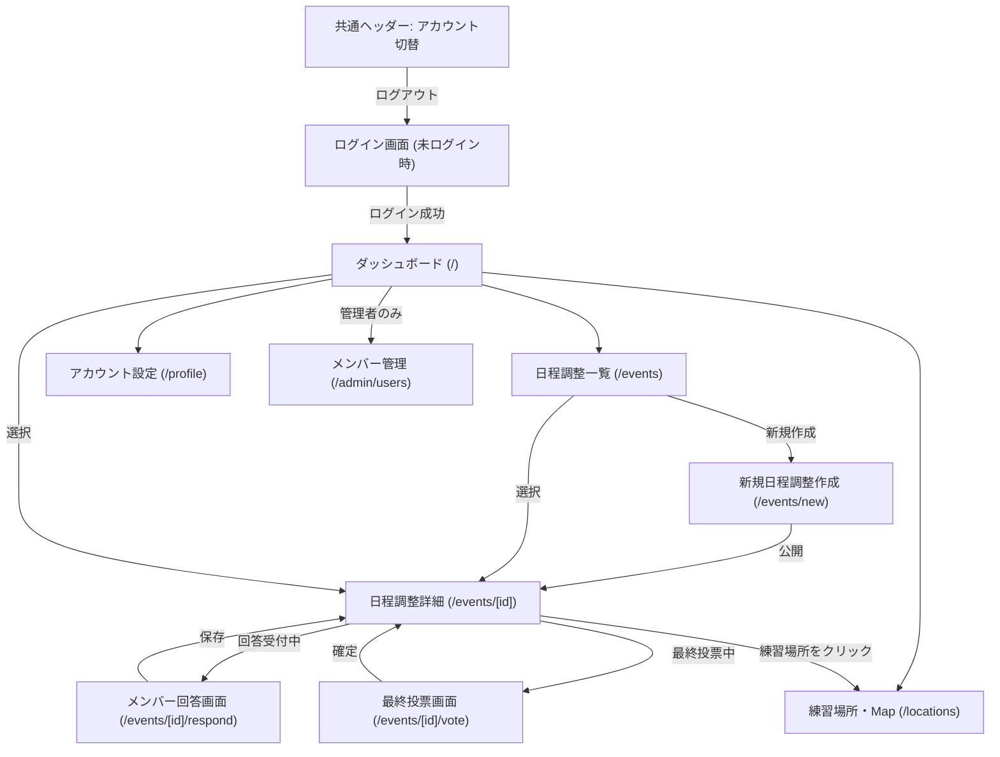

# アカペラバンド運営Webアプリ
## 日程調整機能・画面遷移設計書

**バージョン：2.0（仕様確定版）**

---

## 1. 概要

本アプリでは、バンドメンバー全員が参加可能な日時・練習場所を回答し、最大人数が集まれる枠を自動集計・提示する。
複数候補がある場合は参加可能者による最終投票を実施し、投票期限を迎えると自動確定する。同票が生じた場合のみ幹事が最終決定を行う。

---

## 2. 画面一覧

| No. | 画面名 | パス | 概要 |
|---|---|---|---|
| 0 | ログイン画面 | `/` (未ログイン時) | ID・パスワードで認証。アカウント切替時もここへ遷移 |
| 1 | ダッシュボード | `/` | 進行中・確定・終了した練習、メンバー、練習場所の総合トップ |
| 2 | 日程調整一覧 | `/events` | 状態別タブ（回答受付中/最終投票中/確定済み/練習終了）表示 |
| 3 | 新規作成フォーム | `/events/new` | 候補日または期間指定、30分刻みの練習時間設定、確認プレビュー |
| 4 | 日程調整詳細 | `/events/[id]` | 回答状況公開、場所マップリンク、幹事メニュー（集計・戻す・削除） |
| 5 | 回答画面 | `/events/[id]/respond` | 参加可否、30分刻み時間帯、場所選択&順位（回答受付中のみ利用可） |
| 6 | 最終投票画面 | `/events/[id]/vote` | 最大人数候補カード、期限表示、自動確定判定、同票時幹事決定 |
| 7 | 練習場所一覧 & Map | `/locations` | Google Map埋め込み、施設詳細、新規提案、`?select=id` 連動 |
| 8 | アカウント設定 | `/profile` | あだ名、自己紹介、パスワードの変更 |
| 9 | メンバー管理 (管理者) | `/admin/users` | 管理者専用のアカウント新規発行・一覧管理 |

---

## 3. 全体画面遷移図

---

## 4. 日程調整の進行ステータスと遷移ルール

| ステータス | 状態 | メンバーの回答操作 | 幹事のアクション |
|---|---|---|---|
| **回答受付中** (`open`) | 回答を募っている | **回答・変更が可能** | 回答受付を終了し、集計を実行 |
| **集計完了** (`aggregated`) | 候補が0件だった状態 | 回答不可（締切） | 「回答受付中に戻す (再調整)」 |
| **最終投票中** (`voting`) | 複数候補から投票中 | 回答不可（締切） / **投票可能** | 投票期限終了後、同票時のみ幹事決定 |
| **確定済み** (`confirmed`) | 日時・場所が決定 | 回答不可（締切） | 「回答受付中に戻す (再調整)」 |
| **練習終了** (`completed`) | 練習日時を経過 | 回答不可（アーカイブ） | 過去の実施記録として閲覧のみ |

---

## 5. 画面別詳細仕様

### 5.1 メンバー回答画面 (`/events/[id]/respond`)
- **回答制限**: `event.status === "open"`（回答受付中）の時のみ回答・変更可能。それ以外のステータスではアクセスが遮断される。
- **参加可否**: 「参加可能」または「参加不可」を選択。参加不可ならコメントのみで即保存可能。
- **時間帯の入力**: 30分単位（08:00〜23:00）で開始時刻・終了時刻を設定。1日に複数枠登録可能。
- **練習場所の選択 & 希望順位**:
  - 時間帯ごとに利用可能な施設をチェック選択。
  - チェックした施設に「第1希望」「第2希望」「第3希望」を設定。
  - その場で新しい練習場所を提案可能（提案すると自動でマスタに登録され選択肢に入る）。

### 5.2 集計 & 最終投票画面 (`/events/[id]/vote`)
- **最大参加可能人数の抽出**:
  - 指定された練習時間（30分刻み）を連続して満たし、かつ同じ施設が利用可能なメンバーを抽出。
  - 最大人数が集まれる候補枠のみを提示。
  - 候補が1件のみの場合は集計時に即時自動確定。
- **最終投票の進行ルール**:
  - 各候補日時に「参加可能」と回答したメンバーのみが投票可能。
  - **最終投票期限**（デフォルト: 集計完了から48時間後）を設定。
  - **投票期限内**: 日程の確定は一切行えない（幹事決定ボタンも非表示）。
  - **投票期限終了時**:
    - 最多得票の候補が単独で決まっている場合 ➔ **最多得票候補に自動で確定**。
    - 最多得票が同票の場合 ➔ 場所の希望順位スコアが高い方を優先して自動確定。
    - **得票数も場所スコアも完全同点の場合のみ** ➔ 画面上に幹事決定アラートが表示され、同票候補のカードにのみ幹事決定ボタンが表示される。

### 5.3 練習場所一覧 & Google Map (`/locations`)
- **2カラム構成**: 左側に登録施設カード一覧、右側にGoogle Mapのインライン埋め込み。
- 左側の施設をクリックすると、右側の地図がその施設の場所へスムーズに切り替わる。
- **URLパラメータ連動**: 日程調整詳細画面などから `/locations?select=<locationId>` で遷移すると、指定された施設が自動で選択・ハイライトされ、地図もその場所を表示する。
- 新規登録時に「Google Mapリンク」を入力可能。

### 5.4 アカウント・認証画面
- **ログイン画面**:
  - IDとパスワードで認証。
  - アカウント切り替え時は必ずダッシュボード（`/`）へリダイレクトしてログイン画面を表示。
  - テスト用クイック選択チップを設置。
- **アカウント設定画面 (`/profile`)**:
  - あだ名、自己紹介、パスワードを変更可能。
- **メンバー管理画面 (`/admin/users`)**:
  - 管理者（`isAdmin: true`）のみがアクセス可能。
  - 新規メンバーのID、初期パスワード、あだ名、自己紹介、管理者権限を設定して登録。
